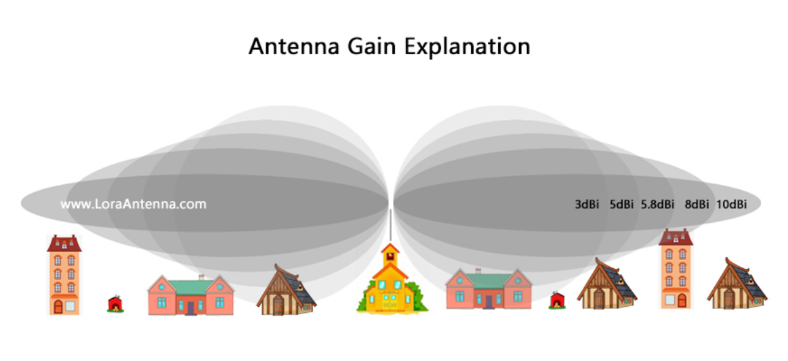
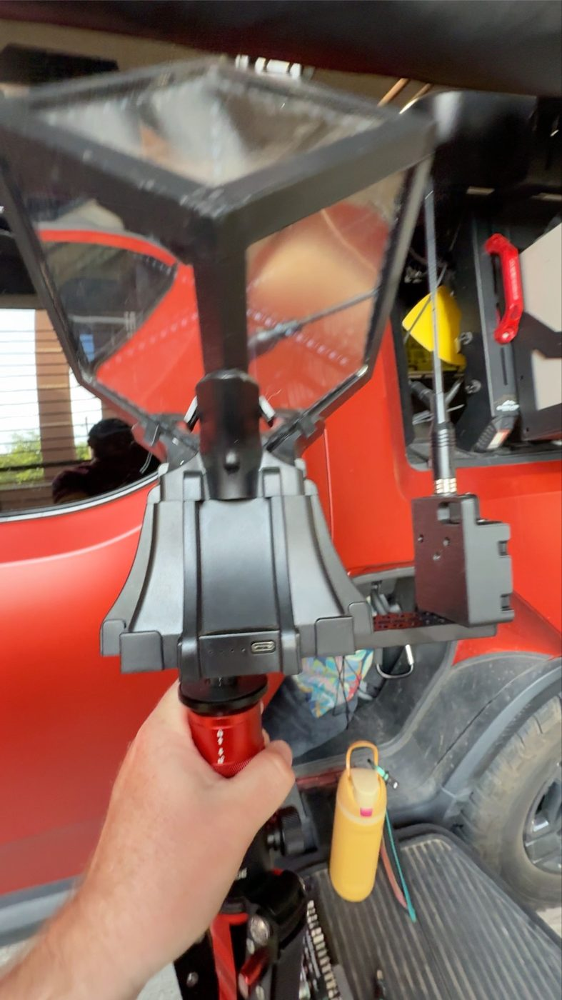
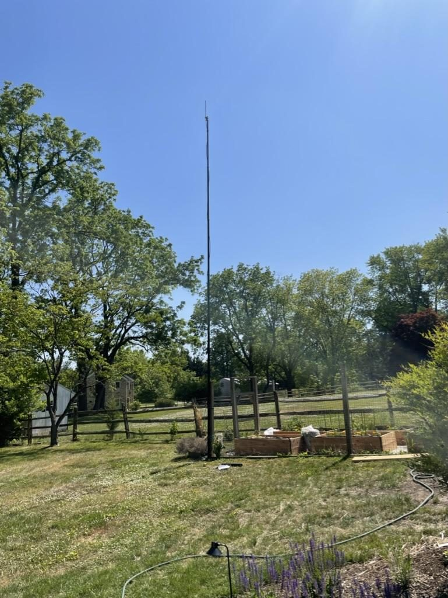
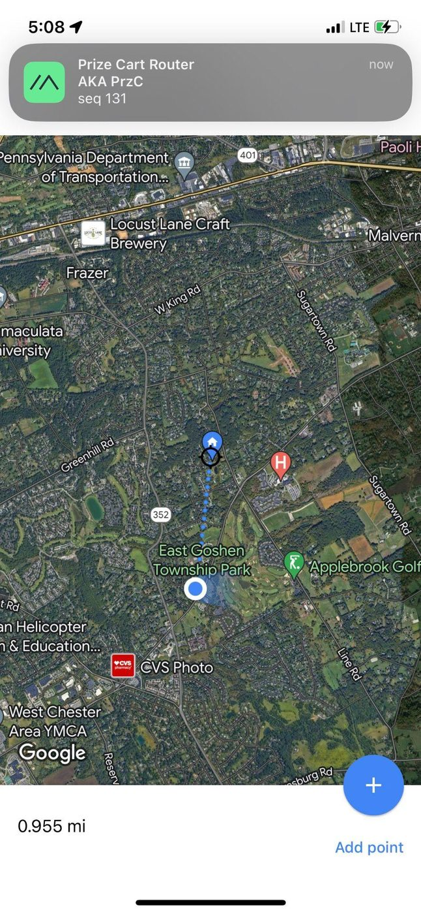

---
hide:
  - navigation
title: Advanced Options
---

# :material-tools: Advanced Options

For folks who want to roll their own hardware, push more power, or experiment with mesh-monitoring software. **Most people don't need this.** A [MeshTracker X1](recommended-hardware.md) and you're set for the Forest.

---

## Camp Node With WiFi: B&Q Station G3

For people who want a camp node they can reach over WiFi, and who'd rather pick their own antenna and cable. This is a **more advanced** node than the [PeakMesh camp nodes](camp-nodes.md): it's a bare radio, so you supply the power, mounting and antenna setup yourself.

|  |  |
|:--|:--|
| **Pros** | More than 1W transmit power (31 dBm by default) &middot; WiFi, so you can manage it over your camp hotspot or local network &middot; SMA antenna jack, so you can use any antenna and cable you like &middot; Modular, with add-on sockets for GPS and sensors |
| **Cons** | No battery, case, solar or built-in GPS &middot; Needs a strong power source: a USB-C PD supply that does 15V (25W+) or a 9–19V DC barrel plug &middot; Ships from China and sometimes sells out |
| **In the box** | The radio and a stock 915 MHz antenna. No USB cable. |
| **What you need** | A good outdoor antenna and a **short** quality cable &middot; A power supply or power bank that can deliver 15V USB-C PD &middot; Something to mount it on, up high |
| **Where to buy** | [BQ Voyage store (official, ~$139, pick US915MHz)](https://store.bqvoy.com/product/mesh-device-station-edition/){ target=_blank } |
| **Guide** | [Meshtastic Station Series docs](https://meshtastic.org/docs/hardware/devices/b-and-q-consulting/station-series/){ target=_blank } |

---

## Software for Power Users

### MeshMonitor

A self-hosted web tool that auto-acknowledges messages and runs auto-traceroutes. Great for nerds running infrastructure nodes — typically deployed on a Raspberry Pi at camp. Helps the mesh self-heal by mapping connectivity automatically.

If you're comfortable with self-hosted tools and a Pi, [check out MeshMonitor](https://meshmonitor.org){ target=_blank }.

### MeshSense

Don't want to mess with a Pi? **MeshSense** runs on your laptop (Mac/PC/Linux) and does auto-traceroutes that help strengthen the mesh. Easier on-ramp than MeshMonitor.

[MeshSense by Affirmatech](https://affirmatech.com/meshsense){ target=_blank }

---

## Antennas (Deep Dive)

Recommended antennas:

- [Muzi 17cm Whip](https://muzi.works/products/whip-antenna-17cm){ target=_blank } — handheld upgrade, SMA male, ~$12
- [ALFA 915 MHz 5dBi N-Type 7" Outdoor](https://atlavox.com/products/antenna-for-meshtastic-915mhz-n-type-outdoor-7-5dbi-alfa-aoa-915-5acm){ target=_blank } — base station omni
- [Rokland 5.8 dBi N-Male Omni Outdoor (large)](https://store.rokland.com/collections/802-11ah-wi-fi-halow/products/5-8-dbi-n-male-omni-outdoor-915-mhz-antenna-large-profile-32-height-for-helium-rak-miner-2-nebra-indoor-bobcat){ target=_blank } — permanent outdoor mounts

Tips:

- **Watch out for fakes on Amazon** — antennas are the most counterfeited Meshtastic accessory. Buy from the trusted sources above.
- For base stations, use quality SMA or N-type cable. **Keep the cable short** — every foot adds signal loss.
- **More dB ≠ more coverage.** A directional high-dB antenna in the wrong orientation has less useful coverage than a modest omni.

{ .ef-advanced-img }

---

## Example Setups

Folks in the community have shared their builds. Drop yours in the [EF Discord](https://discord.com/channels/260909643574935553/1514411058066882671){ target=_blank } (not in the Discord? join at [discord.gg/electricforest](https://discord.gg/electricforest){ target=_blank } first) and we'll feature it here.

### Cube Totem Mount

A T-Echo mounted to a [3D-printed bracket](https://makerworld.com/en/models/519487-lilygo-t-echo-bracket-with-1-4-tripod-mount#profileId-435876){ target=_blank } with a tripod-cheese-board adapter, riding on top of a Hyper Cube totem. Visible from across camp and high enough to push range significantly.

{ .ef-advanced-img }

### G2 Mobile Setup

A Station G2 powered via USB-C, with an SMA cable running out to a roof-mounted antenna on a vehicle. Functions as a mobile base station that follows you to and from camp.

### Test Setup (T-Echo + 1W Base)

1× T-Echo handheld + 1× 1W base station = easily 1+ mile range hip-height. Dead spots at sharp elevation drops or through dense tree cover. Two-node minimum to start seeing real benefit.

{ .ef-advanced-img }

{ .ef-advanced-img }

---

## Need Help?

    [:fontawesome-brands-discord: Ask in the EF Discord](https://discord.com/channels/260909643574935553/1514411058066882671){ .md-button .md-button--primary target="_blank"}

*Not in the Discord? Join at [discord.gg/electricforest](https://discord.gg/electricforest){ target=_blank } first.*{ .discord-helper }
