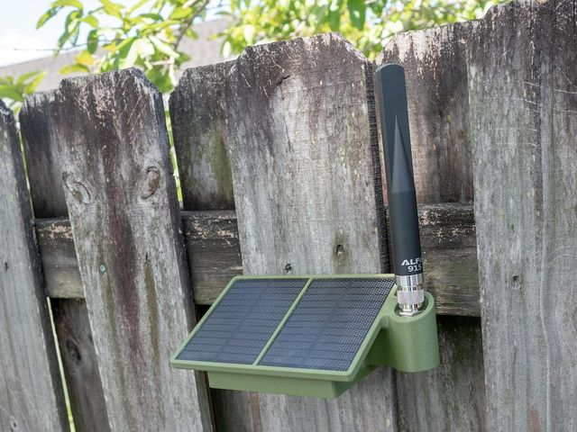
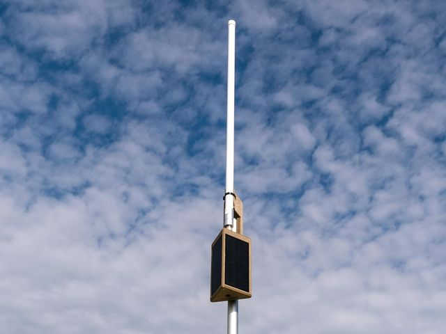
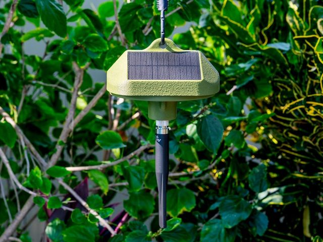
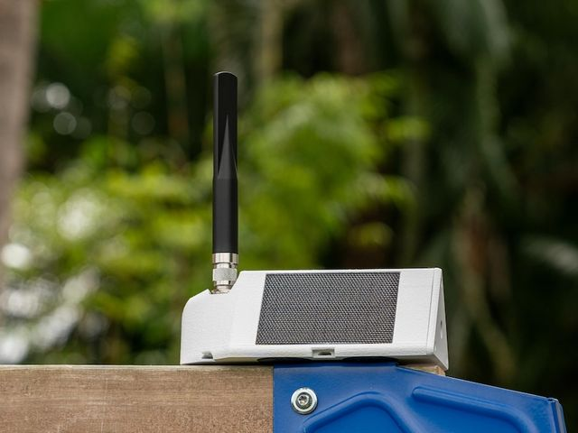
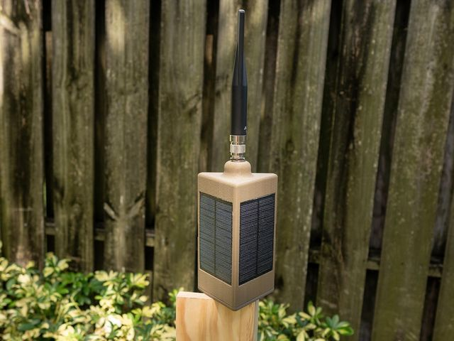

---
hide:
  - navigation
title: Camp Nodes
---

# :material-tower-fire: Setting Up a Camp Node

A camp node is a solar radio you mount up high at camp and leave running all weekend. It helps everyone around you, especially people on small handhelds. **Height is might:** the higher it goes, the more of the Forest it covers.

!!! warning "Leave it on the Client role"
    Even if your node is up high and running all weekend, **do not set it to Repeater or Router** unless someone in the [EF Discord](https://discord.com/channels/260909643574935553/1514411058066882671){ target=_blank } (not in the Discord? join at [discord.gg/electricforest](https://discord.gg/electricforest){ target=_blank } first) has told you it's OK. Misconfigured Router or Repeater nodes break the mesh for the whole Forest. The default `Client` role still helps a ton when it's mounted high.

---

## :material-lightning-bolt: Why We Only Recommend 1W (or Stronger) Camp Nodes

There are lots of solar "repeater" and "base station" nodes for sale, but **most of them use the same small radio as a pocket tracker**: about 22 dBm, or roughly 0.16 watts. Mounted up high they still help a little, but not much more than a handheld would.

A **1-watt** radio (30 dBm) sends about **6 times the power**. In the real world that's roughly **2 to 2.5 times the range**: more with a clear line of sight, less through trees, RVs and crowds. At the Forest, that's often the difference between reaching the rest of the mesh and not.

**How to tell when you're shopping:** look for **"1W"**, **"30 dBm"**, **"High Power"** or **"booster"** in the specs. If it says 22 dBm, or doesn't mention power at all, it's a regular-power node.

!!! note "Power isn't everything"
    Extra power helps your node **send** further. How well it **hears** other nodes still comes down to antenna and height. A 1W node mounted high on a pole beats a 1W node sitting on a cooler.

---

## :material-star: Our Pick: PeakMesh High-Power Solar Node

PeakMesh makes solar Meshtastic nodes in the US that come **assembled and tested**. Charge it, screw on the antenna, mount it up high, and leave it for the weekend. The **High Power** version has a 1-watt radio, so it reaches much further than a regular node.

!!! tip "When you order, pick these options"
    - **Radio:** **RAK High Power Kit**. Not "Standard" and not "DIY No Radio Module".
    - **Antenna:** pick one of the Alfa antennas unless you already have one.
    - **Color:** whatever you like.

Pick the model that fits how you'll mount it at camp:

-   { .ef-card-img loading=lazy }

    **PeakMesh Ultimate**

    ~$180 &middot; Pole, wall, or gutter
    { .ef-card-meta }

    [View on Etsy :material-open-in-new:](https://www.etsy.com/listing/1776412240/peakmesh-ultimate-solar-meshtastic-radio){ target=_blank }

-   { .ef-card-img loading=lazy }

    **PeakMesh Summit**

    ~$205 &middot; Pole mount, extra power
    { .ef-card-meta }

    [View on Etsy :material-open-in-new:](https://www.etsy.com/listing/4593412275/peakmesh-summit-new-extra-power-pole){ target=_blank }

-   { .ef-card-img loading=lazy }

    **PeakMesh Altitude**

    ~$185 &middot; Hangs from a tree
    { .ef-card-meta }

    [View on Etsy :material-open-in-new:](https://www.etsy.com/listing/4331277320/peakmesh-altitude-tree-hanging-solar){ target=_blank }

-   { .ef-card-img loading=lazy }

    **PeakMesh Magnet Mover**

    ~$185 &middot; Magnet, lies flat (car or trailer roof)
    { .ef-card-meta }

    [View on Etsy :material-open-in-new:](https://www.etsy.com/listing/1795541518/peakmesh-magnet-mover-solar-meshtastic){ target=_blank }

-   { .ef-card-img loading=lazy }

    **PeakMesh Magnet Climber**

    ~$185 &middot; Magnet, stands upright
    { .ef-card-meta }

    [View on Etsy :material-open-in-new:](https://www.etsy.com/listing/1795573484/peakmesh-magnet-climber-solar-meshtastic){ target=_blank }

*Prices are with the High Power option, from PeakMesh's Etsy shop, and can change. See the [full PeakMesh shop](https://www.etsy.com/shop/PeakMesh?section_id=50809195){ target=_blank }.*

---

## :material-wrench: High Power Sold Out? Build It Yourself

If the High Power option is sold out, it's easy to put together yourself:

1. Order the same PeakMesh model with the **"DIY No Radio Module"** option. That gets you the case, solar panel and battery, ready for a radio.
2. Order the [RAK WisMesh High Power Booster Starter Kit](https://store.rakwireless.com/products/meshtastic-1w-lora-booster-kit-rak3401?variant=46639158689990){ target=_blank } (~$39). Choose **Battery Powered / 900MHz (US915)**. The 800MHz version won't work in the US.
3. Put the kit in the case. The modules plug together, and PeakMesh's listing photos show the cable routing.

!!! danger "Always connect the antenna before powering it on"
    Running a radio without its antenna attached can damage it.

Stuck? Ask in the Discord. Someone has built one.

---

## :material-arrow-up-bold: Mounting Tips

- **Higher beats everything.** A flag pole, a totem, or the top of a tall structure helps far more than any upgrade.
- **Point the solar panel at open sky,** away from tent shade.
- **If you use an antenna cable, keep it short.** Every foot loses some signal.

---

## The Observatory Stage Letter

The EF Meshtastic community has drafted an open letter to Electric Forest staff asking permission to host a single high-elevation Meshtastic node at the **Observatory Stage**. It would act as a backbone repeater with line-of-sight coverage over the whole grounds.

It's a community-led ask, not endorsed by EF.

[:material-pine-tree: Read the letter](wish-machine-request.md){ .md-button }

---

## Want WiFi or Your Own Antenna?

If you want a camp node you can reach over WiFi, and you'd rather pick your own antenna and cable, we recommend the **B&Q Station G3**. It's more advanced: no battery, case or solar, so you handle power and mounting yourself. See [Advanced Options](advanced.md#camp-node-with-wifi-bq-station-g3).

---

## Need Help With a Camp Node?

    [:fontawesome-brands-discord: Ask in the EF Discord](https://discord.com/channels/260909643574935553/1514411058066882671){ .md-button .md-button--primary target="_blank"}

*Not in the Discord? Join at [discord.gg/electricforest](https://discord.gg/electricforest){ target=_blank } first.*{ .discord-helper }
