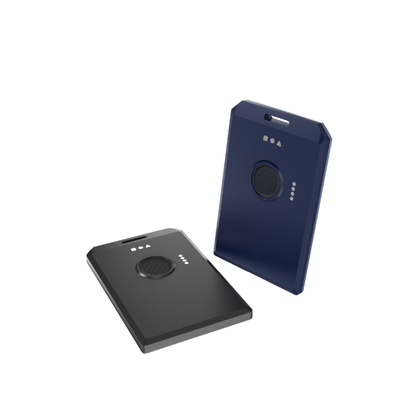
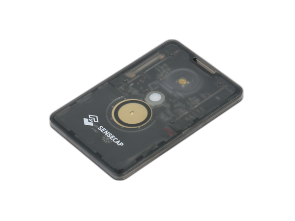

---
hide:
  - navigation
title: Recommended Hardware
---

# :material-radio-handheld: Recommended Hardware for the Forest

You only need **one radio** to get on the mesh. Here's what we recommend. Charge it, pair it with your phone, and you're set.

!!! tip "Short version"
    **Get the [SenseCAP MeshTracker X1](#our-pick-sensecap-meshtracker-x1-50) (~$50).** It charges over a normal USB-C cable, so any phone charger or battery pack at camp works.

    Can't get one in time? The [WisMesh Tag or T-1000-E](#cheaper-or-easier-to-find-last-minute) are great too. They just need their own charging cable.

---

## :material-star: Our Pick: SenseCAP MeshTracker X1 (~$50)

Card-sized, clips to your pack, works out of the box. It has no screen, so you read and send messages in the Meshtastic app on your phone.

|  |  |
|:--|:--|
| **Why we like it** | **Charges with a normal USB-C cable** &middot; Waterproof (IP66) &middot; Up to ~5 days of battery &middot; Built-in GPS so your squad can see where you are &middot; Small and light |
| **Heads up** | No screen &middot; Ships from overseas and sometimes sells out, so **order early** |
| **Where to buy** | [Seeed Studio (official, ~$50)](https://www.seeedstudio.com/sensecap-meshtracker-x1-meshtastic-gps-tracker-p-6935.html){ target=_blank } |

---

## :material-swap-horizontal: Cheaper or Easier to Find Last-Minute

These two work just as well on the mesh and are often cheaper or easier to get quickly, especially on Amazon. Same idea as the X1: card-sized, no screen, use your phone.

!!! warning "These need their own charging cable"
    The WisMesh Tag and T-1000-E charge with a **magnetic clip-on cable**, not USB-C. It comes in the box. **Pack it and don't lose it**, because nobody at camp will have a spare.

-   { .product-image }

    **RAK WisMesh Tag (~$30–50)**

    Cheapest option. Waterproof (IP66), good battery.

    [RAKwireless (~$30)](https://store.rakwireless.com/products/wismesh-tag-meshtastic-gps-lora-tracker-ip66){ target=_blank } &middot; [Rokland (US)](https://store.rokland.com/products/wismesh-tag-from-rakwireless-mokosmart-meshtastic-compatible-card-sized-node-us915-mhz){ target=_blank } &middot; [Amazon](https://www.amazon.com/RAKwireless-MOKOSmart-Meshtastic-Compatible-Waterproof/dp/B0FYHPTPZD){ target=_blank }

-   { .product-image }

    **SenseCAP T-1000-E (~$40–60)**

    Easy to find on Amazon. Make sure it says **T-1000-E**. Other T-1000 models won't work.

    [Seeed Studio](https://www.seeedstudio.com/SenseCAP-Card-Tracker-T1000-E-for-Meshtastic-p-5913.html){ target=_blank } &middot; [Atlavox (US)](https://atlavox.com/products/t1000-e-meshtastic-radio){ target=_blank } &middot; [Amazon](https://www.amazon.com/SenseCAP-Card-Tracker-T1000-Meshtastic/dp/B0DJ6KGXKB){ target=_blank }

---

## :material-cart-outline: Buying Tips

- **Order early.** Stock sells out and overseas shipping can take 2–4 weeks. You'll also want time to set it up and test it before Forest.
- **US sellers ship faster.** Rokland and Atlavox keep stock in the US. Overseas stores can be cheaper, but they're slower and can add customs fees.
- **On Amazon, check the seller.** Make sure it's the exact model above, sold by a real store.

---

## :material-tower-fire: Want to Boost the Mesh for Everyone?

A solar node mounted up high at your camp helps everyone nearby, especially people on small handhelds.

[See the Camp Nodes guide :material-arrow-right-bold:](camp-nodes.md){ .md-button .md-button--primary }

---

## Need Help Picking?

Drop a message in the EF Discord Meshtastic thread. We're happy to help.

    [:fontawesome-brands-discord: Ask the EF Discord](https://discord.com/channels/260909643574935553/1514411058066882671){ .md-button .md-button--primary target="_blank"}

*Not in the Discord? Join at [discord.gg/electricforest](https://discord.gg/electricforest){ target=_blank } first.*{ .discord-helper }
