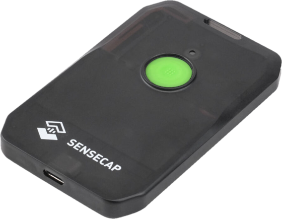

---
hide:
  - navigation
title: Recommended Hardware
---

# :material-radio-handheld: Recommended Hardware for the Forest

You only need **one radio** to get on the mesh. Charge it, pair it with your phone, and you're set.

---

## :material-star: Our Pick

{ .ef-cutout }

### SenseCAP MeshTracker X1

~$50

Card-sized, clips to your pack, works out of the box. There's no screen: you read and send messages in the Meshtastic app on your phone.

- **Charges with a normal USB-C cable**, so any phone charger or battery pack works
- Waterproof (IP66), up to ~5 days of battery
- Built-in GPS so your squad can see where you are

[Buy from Seeed Studio :material-open-in-new:](https://www.seeedstudio.com/sensecap-meshtracker-x1-meshtastic-gps-tracker-p-6935.html){ .md-button .md-button--primary target=_blank }

Ships from overseas and sometimes sells out, so **order early**.
{ .ef-footnote }

**Can't get an X1 in time?** The [RAK WisMesh Tag](https://store.rokland.com/products/wismesh-tag-from-rakwireless-mokosmart-meshtastic-compatible-card-sized-node-us915-mhz){ target=_blank } (~$30–50) and [SenseCAP T-1000-E](https://www.amazon.com/SenseCAP-Card-Tracker-T1000-Meshtastic/dp/B0DJ6KGXKB){ target=_blank } (~$40–60, make sure it says **T-1000-E**) work just as well and are often cheaper or easier to find last-minute, including on Amazon. The catch: they charge with their own **magnetic cable** instead of USB-C, so pack it and don't lose it.
{ .ef-footnote }

---

## :material-cart-outline: Buying Tips

- **Order early.** Stock sells out and overseas shipping can take 2–4 weeks. You'll also want time to set it up and test it before Forest.
- **US sellers ship faster.** Rokland and Atlavox keep stock in the US. Overseas stores can be cheaper, but they're slower and can add customs fees.
- **On Amazon, check the seller.** Make sure it's the exact model above, sold by a real store.

---

## :material-tower-fire: Want to Boost the Mesh for Everyone?

A solar node mounted up high at your camp helps everyone nearby, especially people on small handhelds.

[See the Camp Nodes guide :material-arrow-right-bold:](camp-nodes.md){ .md-button .md-button--primary }

---

## Need Help Picking?

Drop a message in the EF Discord Meshtastic thread. We're happy to help.

    [:fontawesome-brands-discord: Ask the EF Discord](https://discord.com/channels/260909643574935553/1514411058066882671){ .md-button .md-button--primary target="_blank"}

*Not in the Discord? Join at [discord.gg/electricforest](https://discord.gg/electricforest){ target=_blank } first.*{ .discord-helper }
